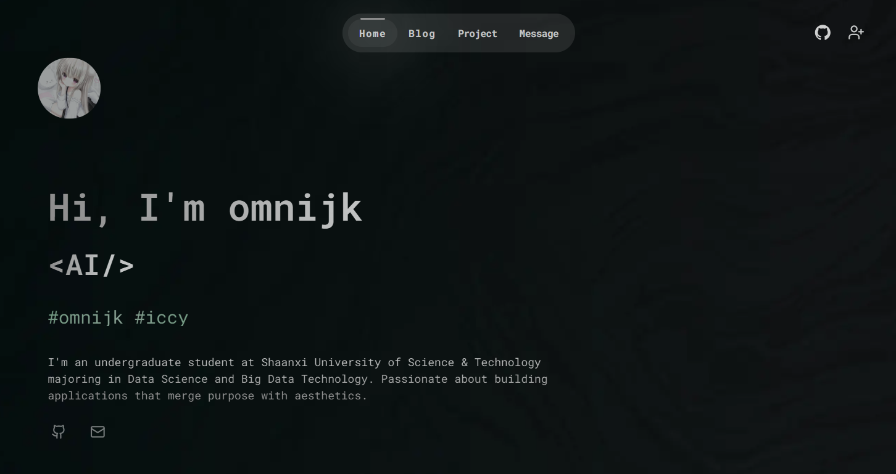

# omnijk.com

一个面向开发者的个人站点：首页、博客、项目、技术栈、经历五个页面。博客文章使用本地 MDX 管理，不需要数据库或任何第三方内容服务。

<p align="center">
  
  
</p>



## 技术栈

- 框架：**Next.js 14（App Router）+ React 18**
- 样式：**Tailwind CSS** + 少量 shadcn/ui 组件
- 动画：**Framer Motion**
- 技术栈图表：**ECharts**
- 内容：**本地 MDX**（`gray-matter` 解析 frontmatter，`next-mdx-remote` 渲染正文）

> 项目当前**不需要 `.env`**，也没有数据库、Redis、Sanity、Clerk、Spotify 等外部依赖，克隆后即可直接运行。

## 快速开始

### 环境要求

- Node.js 18.18 或更高版本（推荐 20+）
- npm

### 安装与开发

```bash
git clone https://github.com/omnijk/omnijk.com
cd omnijk.com
npm install
npm run dev
```

浏览器打开 <http://localhost:3000>。

### 生产构建

```bash
npm run build
npm start
```

`npm start` 默认监听 <http://localhost:3000>，可通过 `PORT` 环境变量修改端口。

### 代码检查

```bash
npm run lint
```

## 目录结构

```
app/                 页面路由
  page.js            首页
  blog/              博客列表与文章详情（/blog、/blog/[slug]）
  project/           项目页（数据来自 lib/project.js）
  tech-stack/        技术栈雷达图
  message/           个人经历时间线
components/          页面组件与 ui 基础组件
content/blog/        博客 MDX 文章
lib/blog.js          读取并解析本地 MDX
lib/project.js       项目列表静态数据
public/              图片、图标、字体等静态资源
```

## 内容维护

- **新增博客**：在 `content/blog/` 下新建 `.mdx` 文件，frontmatter 支持 `title`、`summary`、`image`、`author`、`publishedAt`、`tag`。
- **修改项目**：编辑 `lib/project.js` 中的 `projects` 数组。
- **修改经历**：编辑 `app/message/page.js` 中的 `experiences` 数组。
- **修改技能**：首页技能条在 `components/SkillsBar.jsx`，技术栈页面在 `components/TechStackRadar.jsx`。

## 部署

可直接部署到 Vercel：导入仓库后使用默认的 Next.js 构建配置即可，无需配置环境变量。

## 致谢

- 站点灵感来自 [zephyrlin](https://zephyrlin.me)。
- 感谢 omnifj 的帮助与指导。
